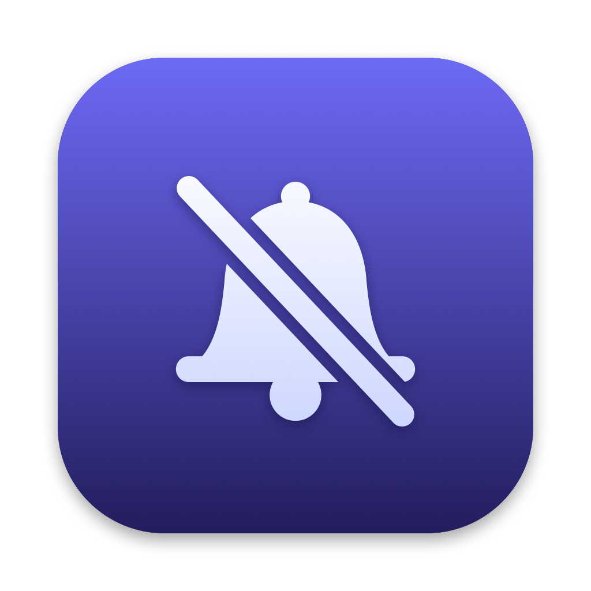

<p align="center"></p>

# HushUp

Stop OS updates and silence the "update available" nags: the red badge on
System Settings in the Dock and the **Software Update Available** row in its
sidebar. Your machine, your schedule.

- `hushup`: Rust CLI + background guard (does all the work)
- `HushUp.app`: Swift menu bar app on top of the CLI

Platforms: **macOS** now. Windows and Linux are next (see Roadmap).

## How it works (macOS)

Every change is recorded and undone by `hushup restore`.

| Layer | What it does |
|---|---|
| Preferences | `AutomaticCheckEnabled`, `AutomaticDownload`, `AutomaticallyInstallMacOSUpdates` → `false` in `/Library/Preferences/com.apple.SoftwareUpdate` |
| Badges | Clears `RecommendedUpdates` (what System Settings counts) plus per-user `AvailableUpdatesNotificationCountKey` / `AttentionPrefBundleIDs`, then restarts the Dock |
| Hosts | Points `swscan`, `swdist`, `swcdn`, `updates.cdn-apple.com`, `gdmf.apple.com` at `0.0.0.0` / `::` so a scan can't refill the list |
| Guard | launchd daemon re-runs `hushup enforce` every 15 min and whenever softwareupdated rewrites its prefs |

Security data (XProtect, `ConfigDataInstall`/`CriticalUpdateInstall`) is left
on by default. Pass `--block-security-data` only if you really mean it.

To update manually later: `sudo hushup restore`, update, then `apply` again.

## Usage

```sh
cargo build --release
./target/release/hushup status
sudo ./target/release/hushup apply --dry-run   # preview every change
sudo ./target/release/hushup apply             # --no-hosts to skip /etc/hosts
sudo ./target/release/hushup install-daemon    # copies itself to /usr/local/bin
sudo hushup uninstall-daemon && sudo hushup restore
```

Menu bar app:

```sh
./scripts/bundle-app.sh    # → dist/HushUp.app (ad-hoc signed)
open dist/HushUp.app
```

## Layout

```
src/main.rs                 CLI
src/platform/mod.rs         shared types, picks the OS module
src/platform/macos.rs       macOS implementation
src/platform/unsupported.rs placeholder for other OSes
app/                        Swift menu bar app (SwiftPM)
scripts/bundle-app.sh       builds HushUp.app
```

Adding an OS = a new `src/platform/<os>.rs` with the same functions.

## Roadmap

- Windows: Windows Update policies (`NoAutoUpdate`, `TargetReleaseVersion`), pause/`wuauserv`, toast suppression; GUI likely Tauri 2
- Linux: unattended-upgrades / dnf-automatic / PackageKit / GNOME Software notifications
- macOS: SMAppService privileged helper instead of the AppleScript password prompt; notarized release

## Caveats

- Updates macOS found **before** you ran `apply` stay in softwareupdated's
  cache (`/Library/Updates`, protected by SIP) and keep the badge until they're
  installed. `hushup status` lists them. Install them once, e.g. for a
  Command Line Tools update:
  `sudo hushup restore && softwareupdate -i "<label>" && sudo hushup apply`
  (`softwareupdate --list --no-scan` shows the label). New ones won't show up.

- Skipping updates means skipping security fixes. Re-enable regularly.
- Apple changes where the badge comes from between macOS versions; open an
  issue with `hushup status` output if a badge survives.
- MDM-managed Macs may enforce updates regardless.

## License

MIT
